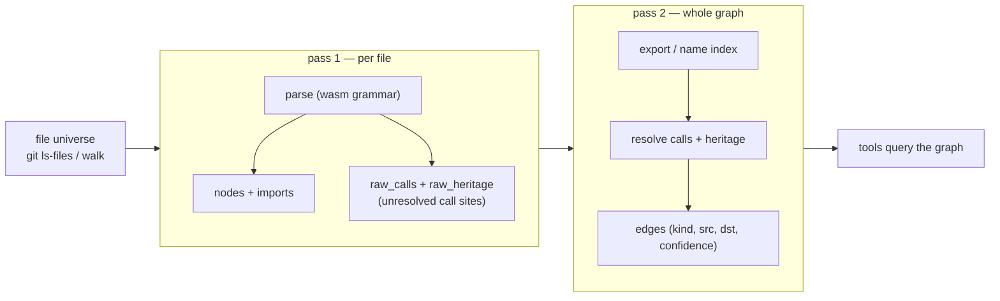
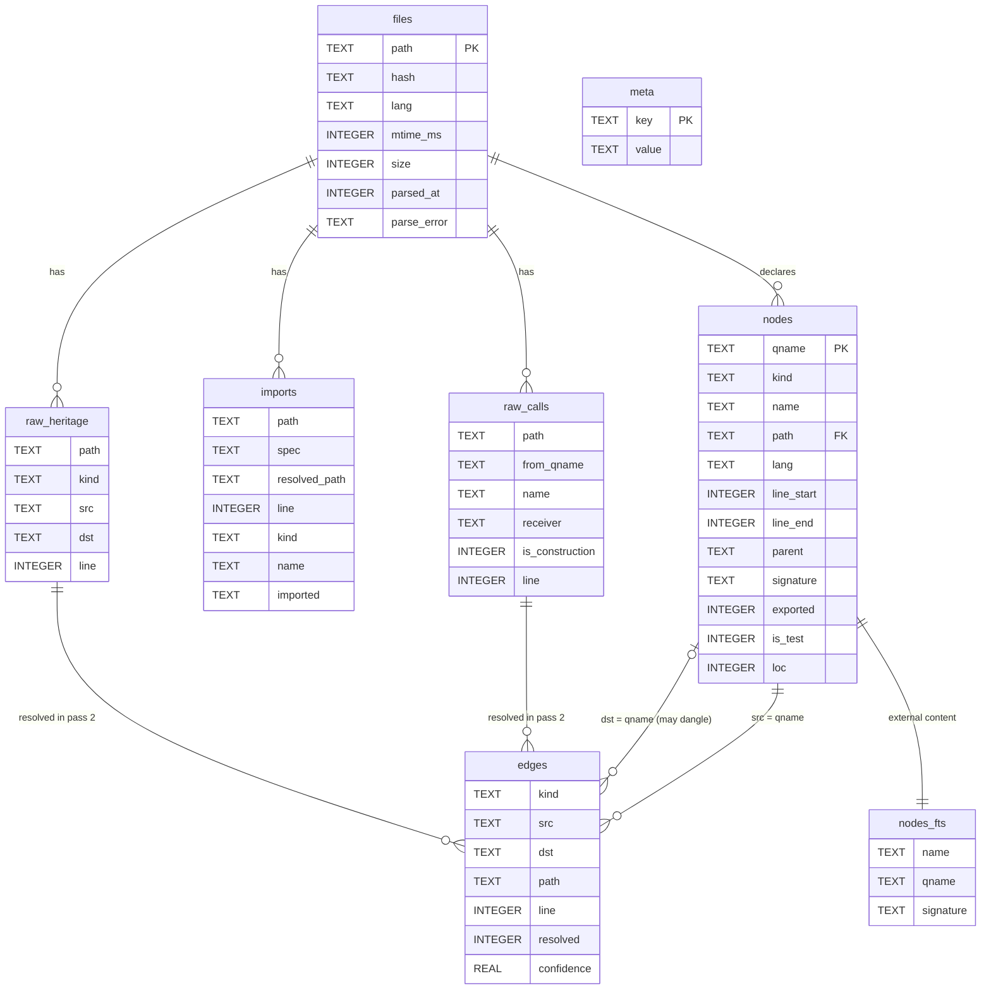
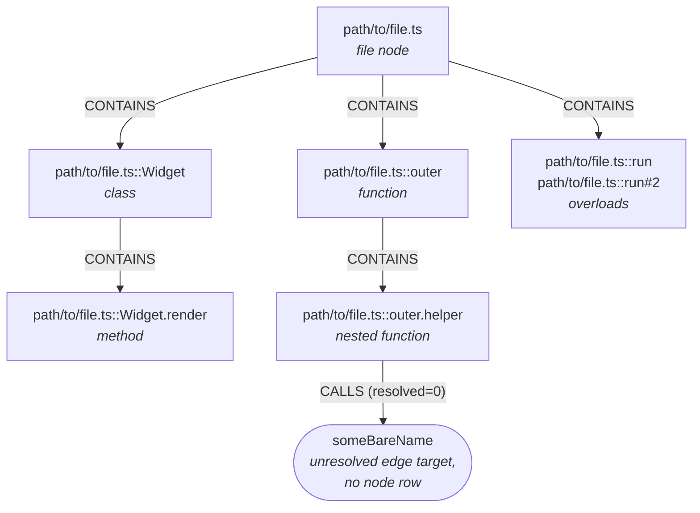
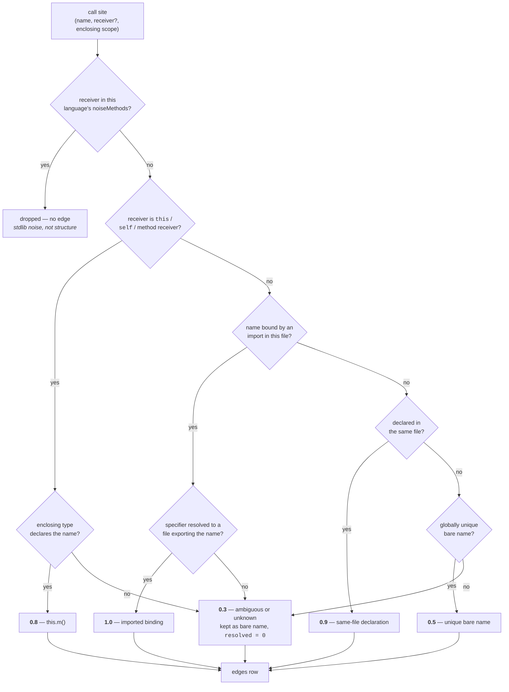

# Design

Internals of `dsh-code-graph`: how the index is built, how it is stored, how calls are resolved,
and what the four tools actually return. For installation and usage, see the [README](README.md).

## In-process and offline

Everything runs **in-process and offline**. No network calls, no telemetry, no MCP server. The
plugin is a Cordis plugin that registers four tools against a locally built SQLite graph; the only
external dependency is `git`, and even that is optional.

### Parsing

- `web-tree-sitter` with prebuilt `.wasm` grammars — no compiler toolchain at install time.
- **WASM rather than native bindings, deliberately**: package managers block `node-gyp-build`
  install scripts by default, so a native `tree-sitter` build is a support burden the plugin
  refuses to take on.
- **TypeScript/JavaScript keep a dedicated walker** (`src/parse/ts-extract.ts`). The import graph is
  statically resolvable, so the walker can do more than a query can express: barrel re-export
  following, `tsconfig` path aliases, `this.` receiver rewriting.
- **Every other language uses a query pack** (`src/parse/query-extract.ts`): a tree-sitter query
  file with `@definition.*` / `@call` / `@heritage.*` captures. Adding a language is a wasm grammar
  plus a query file, not a new AST walker.
- Java, Go and Rust are query-pack languages (`@lumis-sh/wasm-java`, `@lumis-sh/wasm-go`,
  `@lumis-sh/wasm-rust`).
- A query pack also carries its per-language `noiseMethods` list — see
  [Call resolution](#call-resolution-and-why-it-is-honest).
- Grammars and compiled queries are cached per process and disposed with the plugin fiber
  (`disposeGrammars`, `disposeQueries`).

### Storage

- The built-in `node:sqlite` (`DatabaseSync`, stable and non-experimental as of Node 26). No native
  database dependency, no `better-sqlite3`, nothing to compile.
- **FTS5** (`nodes_fts`) for symbol search, as an *external-content* table over `nodes`: FTS5 stores
  no copy of the indexed text, so removing an entry means handing back the exact values indexed
  under that rowid.
- **WAL journaling**, so a background build and a foreground query do not block each other.
- Writes are batched into shared transactions; the schema carries a `schema_version` (currently 8)
  in `meta`, and a version mismatch rebuilds from scratch rather than migrating.

### Location

- The index lives **outside the repository**, at
  `$DSH_HOME/storages/code-graph/<hash-of-repo-path>/graph.db`.
- It therefore never pollutes the working tree, needs no `.gitignore` entry, and survives clean
  checkouts.
- `$DSH_HOME` defaults to `~/.dsh`, resolved the same way the harness itself resolves it.
- **All stored paths are repo-relative**, so the database is not invalidated by moving the checkout
  — only the path hash that selects it is.

### Incremental freshness

- The index stays honest about edits the agent performs. Two signals mark a file dirty:
  - the `fs/observed` event, for edits the agent makes through the harness (subscribed defensively
    and untyped, so the plugin still loads in a composition without the filesystem stack);
  - out-of-band git working-tree modifications, detected by a `git` state check on every query.
- **The rebuild is lazy**: the event listener only marks the path dirty (it must stay synchronous —
  a throw there would fail the observing tool call). The next query triggers the targeted rebuild.
- A targeted rebuild purges deleted files, re-parses changed files, and **re-resolves every edge**
  from the persisted raw call sites — unchanged files re-resolve against the new export index too.
- Every tool result carries a `freshness` record: `status` (`ready` / `building` / `stale`), the
  indexed `head` commit, `dirtyFiles`, `builtAt`, and `rebuiltFiles` / `rebuiltDeleted` for the last
  incremental pass.
- The first call on an unindexed repository starts a background build and returns
  `status: "building"` with progress rather than blocking.

### File universe

- `git ls-files` is the primary enumeration — it applies `.gitignore` for free. `git` is the only
  external dependency.
- A **bounded directory walk** is the fallback when git is unavailable.
- The two enumerate **different universes** — the walk skips build output and dot-directories — so
  the index records which one built it, in `meta.file_source`.
- If git later becomes unavailable, the incremental pass **will not treat the fallback listing as
  proof of deletion**: it purges only files actually gone from disk, and defers discovering new ones
  until a trustworthy listing is available again.

### Build pipeline

Call resolution needs to know what every file exports before it can resolve anything, so a build is
two passes over the file set:



- Pass 1 buffers its writes and flushes them in batches, to amortize WAL commits.
- `raw_calls` / `raw_heritage` are **persisted**, not transient: that is what lets an incremental
  build re-run pass 2 for the whole graph after re-parsing only the delta.
- A full build skips the per-file purge entirely (a contentless-FTS scan that cost seconds on a
  large repository), and filesystem existence probes during import resolution are cached.

## Schema

Two string-keyed tables joined on qualified names, so an unresolved edge target can dangle
harmlessly as a bare name instead of forcing a fabricated node.



- **No foreign keys.** Every relationship above is a string join on `path` or `qname`. That is the
  point: `edges.dst` may name a symbol that has no `nodes` row, and such an edge is kept and marked
  `resolved = 0` rather than dropped or backed by an invented node.
- `raw_calls` / `raw_heritage` hold the pass-1 output. They exist so pass 2 can be re-run for the
  whole graph after an incremental re-parse of a few files.
- `nodes_fts` is external-content FTS5 over `nodes` — no duplicated text, and only `name`, `qname`
  and `signature` are indexed.
- Indexes cover the query shapes the tools actually use: `edges(src, kind)` and `edges(dst, kind)`
  for relations and impact, `nodes(path)` / `nodes(name)` / `nodes(kind)` for find and overview.

### Qualified names



- The form is `path/to/file.ts::symbol`; methods are `path/to/file.ts::Class.method`.
- **A qname carries no arity and no parameter types.** Declarations that would collide — method
  overloads, TypeScript declaration merging — keep the first one bare and discriminate the rest with
  `#2`, `#3`.
- Every declaration stays its own node with its own signature and line range. A call that cannot be
  told apart by name resolves to the bare qname.
- **A declaration inside another declaration's body is a node too**, its enclosing scope encoded the
  same way: `outer`'s local helper is `path/to/file.ts::outer.helper`.
  - Its calls are attributed to it, not to `outer`.
  - The `CONTAINS` edge `outer -> outer.helper` is what keeps `code_impact` reaching `outer`
    through it.
- **Plain local bindings are not nodes** (`const n = 1`); calls in their initializers stay attributed
  to the enclosing declaration.

### Signatures

- Signatures **name** a symbol, they never **quote** it.
- A callable carries its parameter list: `run(n: number): number`.
- A type carries its declaration keyword: `class Widget`, `trait Drawable`, `type Handler interface`.
- **No declaration body ever reaches `signature`.** Two consequences the tools depend on:
  - a `code_find` hit stays around fifteen characters;
  - searching a method name cannot return its enclosing type, because the type's signature does not
    contain its members.

## Call resolution, and why it is honest

The reference project matches call targets by bare name and then patches up the damage with seven
per-language heuristic resolvers. For TypeScript the import graph is statically resolvable, so this
plugin resolves properly instead.

A diagram earns its place here: the confidence score is not a table lookup but the outcome of an
ordered ladder, and the ordering is the design.



| Confidence | Rule |
|---|---|
| `1.0` | imported binding — the specifier resolved to a file that exports the name |
| `0.9` | same-file declaration |
| `0.8` | `this.m()` where the enclosing class declares `m` |
| `0.5` | globally unique bare name |
| `0.3` | ambiguous or unknown → kept as an unresolved bare name, `resolved = 0` |

### Import specifier resolution

- Relative paths, with the usual extension and `index` probing.
- `tsconfig.json` `paths` / `baseUrl` aliases.
- Workspace `package.json` entry points.
- **Barrel re-exports are followed transitively** — `export { x } from './y'` and
  `export * from './y'`.
  - This matters enormously in a package-per-directory repository: without it, only 2 of 40 genuine
    `defineTool` callers in the harness resolved confidently; with it, all 40 do.

### What is never done

- **Nothing is fabricated.** Unresolvable targets are retained and marked, never dropped and never
  given an invented node.
- **Every tool reports confidence**, so the agent knows when to fall back to `grep`.
- **Receiver-qualified builtin calls are dropped as noise** rather than stored as phantom structure.
  - The list is **per-language**, because `get` / `add` / `clear` / `parse` are stdlib noise in
    TypeScript and ordinary user-defined methods in Go and Rust.
  - Each query pack carries its own list (`QueryPack.noiseMethods`); a language without one drops
    nothing.
- **Centrality counts only confident calls.** `code_overview` hubs and `code_find` caller counts
  require `resolved = 1 AND confidence >= 0.8`; otherwise the 0.5 unique-name fallback dominates —
  a lone `map` helper in a script collected 1245 phantom callers from every unrelated `.map(...)` in
  the repository.

### Per-language resolution notes

- **Java** — FQCN → file via `package` + filename; same-package types without an import;
  `import pkg.*` wildcards; `import static`. Instance calls without a type qualifier (`s.run()`)
  stay honest — unique-name at 0.5 or unresolved — because there is no type inference.
- **Go** — `go.mod` module path + directory → package files. `import "mod/pkg"` is a namespace
  (`pkg.Foo`); `import alias` / `import .` / same-package names work like Java's named and wildcard
  bindings. Methods attach to the receiver type even when they live in another file of the package.
  `s.m()` inside a method whose receiver is `s` rewrites to `this.m()` (0.8). Implicit interface
  satisfaction is not recorded.
- **Rust** — `Cargo.toml` package + `mod foo;` → `foo.rs` / `foo/mod.rs`. `use crate::` / `super::` /
  `self::`, named / glob / aliased uses, and workspace-local crate names. Methods in `impl` attach to
  the type even in another module. `self.m()` rewrites to `this.m()` (0.8). `impl Trait for Type` is
  `IMPLEMENTS`. Proc-macros are not followed.

## Tools

Four tools, one shared envelope.

- Every result is **compact JSON** with a token budget: `max_tokens`, default 1500 (2000 for
  `code_impact`), hard cap 6000.
- **Truncation drops whole lowest-ranked rows** and sets `truncated`, never cutting a record in half.
- `truncated` covers **every** reason rows are missing — including the per-relation cap of 30 that
  `code_relations` applies before the budget is even consulted. A section that returns fewer rows
  than it holds always says so.
- **Every result carries `freshness`**, spread onto it at registration rather than by each tool, so
  "every result reports freshness" is a property of the plugin, not of copy-paste.
- No tool is concurrency-safe (`isConcurrencySafe: () => false`): one index acquisition at a time.
- When the index is not usable, the tool returns the not-ready envelope instead of its own shape:

```json
{ "status": "building",
  "message": "Index is still building.",
  "progress": { "parsed": 812, "total": 2776, "phase": "parse" } }
```

```json
{ "freshness": { "status": "ready", "head": "262d88d1", "dirtyFiles": 0,
                 "builtAt": 1756051948000, "rebuiltFiles": 3, "rebuiltDeleted": 0 } }
```

### `code_overview`

- **Cheap orientation — the call to make first.** Repository size, languages, module layout,
  most-called symbols, entry points, and suggested next calls.
- `focus` scopes it to one directory, which is why architecture overview needs no separate tool.
- `focus` is a **directory prefix only** — a file path or a symbol name matches nothing and comes
  back as `status: "empty"` rather than as a zero-filled `ready`.
- `modules` groups files by parent directory, capped at two path segments (one deeper than `focus`),
  so a flat `src/` tree does not report per-file "modules". `outbound` counts `IMPORTS` edges leaving
  the directory — a coupling proxy.
- `hubs` ranks by distinct **confident** callers; tests are excluded.
- `entryPoints` are non-test files that import something and that nothing imports.
- `next` is literal suggested follow-up calls, filled from the top hub.

```json
{
  "status": "ready",
  "repoRoot": "/home/me/Projekte/deepseek-harness",
  "focus": null,
  "totals": { "files": 2776, "symbols": 25355, "edges": 112131, "tests": 1841,
              "callResolution": 0.59 },
  "languages": [{ "lang": "typescript", "files": 2604 }],
  "modules": [{ "dir": "packages/core", "files": 214, "symbols": 2611, "outbound": 388 }],
  "hubs": [{ "qname": "packages/dsh-tools/src/define.ts::defineTool", "name": "defineTool",
             "path": "packages/dsh-tools/src/define.ts", "line": 42,
             "kind": "function", "callers": 40 }],
  "entryPoints": ["packages/cli/src/main.ts"],
  "next": ["code_relations symbol=\"defineTool\" — inspect the most-called symbol"],
  "truncated": false
}
```

### `code_find`

- Find symbols by name, returning each one's **exact file, line, and signature — never file bodies**.
- Use the returned `path` and `line` with the ordinary `read` tool when the body is actually needed.
- Reports `callers` / `callees` counts (confident edges only) so central code is distinguishable from
  incidental code.
- Candidates come from an **FTS5 match unioned with an exact-name lookup**, so a short or
  punctuation-heavy query still finds its symbol when FTS yields nothing. A malformed FTS expression
  degrades to the exact-name lookup rather than failing the call.
- Ranking is deliberately simple and explainable: exact name → prefix → FTS relevance, then exported,
  then caller count, then shortest name.
- Optional filters: `kind` (function, method, class, interface, type, enum, var), `path_glob`,
  `limit` (default 40, max 200).
- `total` is the true match count before `limit` and before the budget.

```json
{
  "hits": [{ "qname": "src/query/find.ts::findSymbols", "kind": "function", "name": "findSymbols",
             "path": "src/query/find.ts", "line": 56,
             "signature": "findSymbols(db: GraphDb, opts: FindOptions)",
             "exported": true, "isTest": false, "callers": 3, "callees": 2 }],
  "total": 4,
  "truncated": false,
  "budget": { "used": 271, "limit": 1500 }
}
```

### `code_relations`

- Inspect **all** structural relations of one symbol: `callers`, `callees`, `imports`,
  `inheritsFrom` / `inheritedBy`, `implements` / `implementedBy`, `testedBy`, `references`,
  `contains`.
- Each edge carries `resolved` and `confidence`, so you know which are real and which are guessed.
- `symbol` accepts a bare name, a file path, or a full qname.
- **At most 30 edges per relation.** `counts` reports how many each one actually has, so
  `callers: 30` against `counts.callers: 60` is legible as half the picture rather than all of it.
- The remaining budget is split evenly across the sections that have data, so one huge section cannot
  starve the rest.
- **A bare name matching several symbols is *ambiguous*, not missing**: `found` is `false` and
  `candidates` lists the matching qnames. Re-ask with one of them — no `grep` fallback needed.
- Use after `code_overview` to drill into the `hubs` section.

```json
{
  "symbol": "src/query/find.ts::findSymbols",
  "found": true,
  "metadata": { "kind": "function", "path": "src/query/find.ts", "line": 56, "exported": true },
  "relations": {
    "callers": [{ "kind": "CALLS", "src": "src/index.ts::apply.run", "dst": "src/query/find.ts::findSymbols",
                  "line": 174, "resolved": 1, "confidence": 1.0 }],
    "callees": [{ "kind": "CALLS", "src": "src/query/find.ts::findSymbols", "dst": "src/query/budget.ts::fitRows",
                  "line": 154, "resolved": 1, "confidence": 1.0 }]
  },
  "counts": { "callers": 1, "callees": 6, "imports": 0, "testedBy": 2, "references": 0, "contains": 0 },
  "candidates": [],
  "truncated": false
}
```

Ambiguous form:

```json
{ "symbol": "run", "found": false, "candidates": ["src/a.ts::Service.run", "src/b.ts::Job.run"],
  "counts": { "callers": 0, "callees": 0 }, "truncated": false }
```

### `code_impact`

- Show what would be affected by a change to one or more files or symbols.
- Traces **reverse** dependencies — who calls / imports / inherits from / implements / tests /
  references the target — through up to five BFS layers (`max_depth`, default 3).
- **A file target stands for the whole file**: the file node *and every symbol declared in it* are
  seeded at depth 0, so callers of those symbols are reached. Without that, a file target would only
  find the files that import it — a file node's only reverse edges are `IMPORTS`.
- Seeds are marked `relation: "target"` (named directly) or `"target-member"` (pulled in by a file
  target); everything else carries the edge kind that reached it.
- **First arrival wins**: a node is recorded at the shallowest depth that reaches it. `depth` is
  exact; `relation` and `confidence` describe the edge that happened to arrive first in that layer,
  not the strongest one.
- One bulk SQL query per BFS layer, chunked so a frontier wider than SQLite's parameter limit still
  runs. A layer that hits its edge cap sets `truncated`.
- Targets absent from the index come back in `unresolved`; a bare name matching several symbols comes
  back in `ambiguous` with its candidate qnames — **the two cases stay distinguishable**.
- Use before editing to scope your test plan and spot breaking changes.

```json
{
  "paths": ["src/query/find.ts", "src/util.ts::helper"],
  "affected": [
    { "qname": "src/query/find.ts::findSymbols", "kind": "function", "name": "findSymbols",
      "path": "src/query/find.ts", "line": 56, "depth": 0, "relation": "target-member",
      "confidence": 1 },
    { "qname": "src/index.ts::apply.run", "kind": "function", "name": "run",
      "path": "src/index.ts", "line": 173, "depth": 1, "relation": "CALLS", "confidence": 1.0 }
  ],
  "totalAffected": 27,
  "maxDepth": 3,
  "unresolved": ["src/util.ts::helper"],
  "ambiguous": [{ "target": "run", "candidates": ["src/a.ts::Service.run", "src/b.ts::Job.run"] }],
  "truncated": false
}
```
